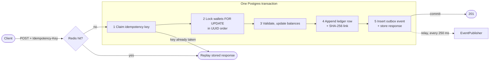
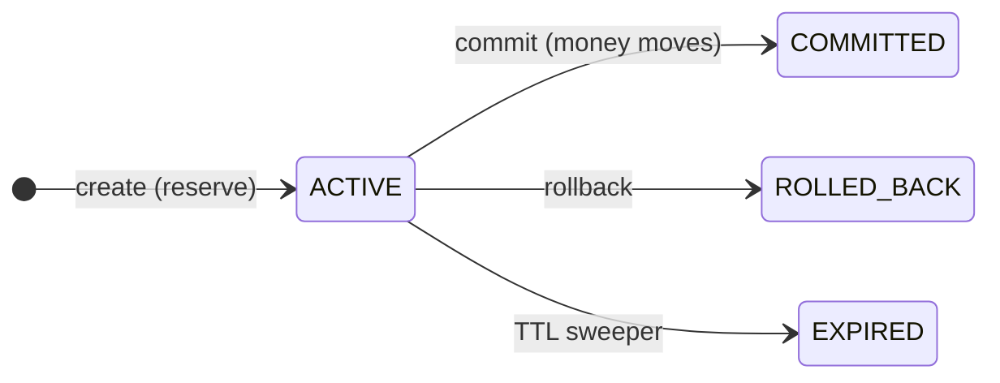
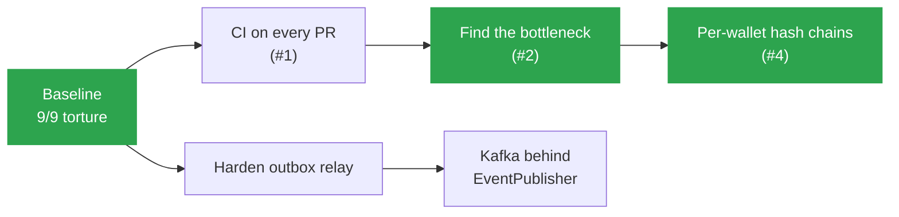

<div align="center">

# fault-tolerant-payment-service

### A wallet ledger that keeps money consistent.


[](LICENSE)

[Overview](#overview) · [Quick start](#quick-start) · [How it works](#how-it-works) · [Torture suite](#torture-suite) · [Measured](#measured) · [Roadmap](#roadmap) · [Design](docs/technical-design.md)

</div>

## Overview

Deposits, withdrawals, transfers, and holds between wallets, recorded in an
append-only, hash-chained ledger. Each failure below is reproduced against the
real jar by a torture scenario:

| Failure | Defense | Result |
|---|---|---|
| 100 withdrawals race, funds for 10 | `SELECT ... FOR UPDATE` + `CHECK (balance >= 0)` | 10 succeed, 90 refused, balance 0 |
| A→B and B→A at once | lock both wallets in UUID order | 100/100 succeed, no deadlock |
| Client retries 100× | idempotency key claimed inside the money transaction | applied once |
| Redis down during retries | Postgres is the authority, Redis only a cache | still applied once |
| Crash after commit, before publish | transactional outbox | event published after restart |
| Crash after publish, before mark | at-least-once relay + dedup on `event_id` | delivered 2×, applied 1× |
| Hold commit races TTL expiry | one compare-and-set on hold status | one winner per hold |
| Ledger row edited in the DB | SHA-256 hash chain | broken `seq` reported |
| Balances drift from history | append-only ledger | all balances rebuilt from it |

Money is `long` minor units end to end. No floating point.

## Quick start

```bash
docker compose up -d          # Postgres :5432, Redis :6379
mvn package
java -jar target/fault-tolerant-payment-service-0.1.0-SNAPSHOT.jar   # :8080
```

Deposit twice with the same key; it applies once:

```bash
W=$(curl -s -X POST localhost:8080/wallets -H 'Content-Type: application/json' \
      -d '{"ownerName":"alice"}' | jq -r .id)

for i in 1 2; do
  curl -s -X POST localhost:8080/deposits -H 'Content-Type: application/json' \
    -H 'Idempotency-Key: dep-1' -d "{\"walletId\":\"$W\",\"amount\":5000}"; echo
done

curl -s localhost:8080/wallets/$W       # balance 5000, not 10000
```

<details>
<summary><b>HTTP surface</b></summary>

| Endpoint | Body | Idempotency-Key |
|---|---|:---:|
| `POST /wallets` | `ownerName` | |
| `GET /wallets/:id` | | |
| `POST /deposits`, `/withdrawals` | `walletId`, `amount` | ✓ |
| `POST /transfers` | `fromWalletId`, `toWalletId`, `amount` | ✓ |
| `POST /holds` | `walletId`, `amount`, `ttlSeconds` | ✓ |
| `POST /holds/:id/commit` | `destinationWalletId` | ✓ |
| `POST /holds/:id/rollback` | | ✓ |
| `GET /ledger/entries?walletId=&limit=` | | |
| `GET /ledger/verify` | | |
| `GET /health` | | |

Errors: `{"error":{"code","message"}}`. Insufficient funds `422`, hold not active `409`.

</details>

## How it works

One money request = one Postgres transaction:



A hold reserves money without moving it. Only commit writes a ledger entry, and
every transition goes through one compare-and-set on `status = 'ACTIVE'`:



<details>
<summary><b>Repository map</b></summary>

```
src/main/java/com/nnviet/payment/
├── common/db/Tx         the only transaction boundary (JDBC on a worker pool)
├── common/idempotency/  claim-or-replay in Postgres, Redis fast path
├── common/chaos/        hard-kill points for the torture suite
├── wallet/              create and read wallets; never moves money
├── ledger/              workflows (one op = one txn) composed of small tasks
└── outbox/              same-transaction writer, relay, publisher port
src/test/.../torture/    9 scenarios against the real jar
tools/                   load and restart benchmarks
```

</details>

## Torture suite

```bash
docker compose up -d
mvn -Ptorture verify          # wipes all tables and Redis: dev stores only
```

Each scenario runs the shaded jar as a subprocess, attacks it (races, retries,
`Runtime.halt` at a named point), then checks invariants in Postgres.
**9/9 passed** on 2026-07-19. Report: `target/target/torture-report.md` (nested
path is a known bug, see [#1](https://github.com/nnviet06/fault-tolerant-payment-service/issues/1)).

## Measured

One laptop (i7-11800H, 8 cores) running service, Postgres, and Redis. Details:
[benchmark-report.md](docs/benchmark-report.md).

| What | Result | Condition |
|---|---|---|
| Committed transfers | **~940 tps, 0 errors** | 32 clients, 1000 wallets (~380 tps with 20 wallets) |
| Double-spend race | **0 violations** | 100 concurrent withdrawals |
| Pending event after crash | **published 30.5 ms after restart** | median of 20, bounded by the 250 ms relay poll |

Before #4, one global ledger lock capped throughput at ~230–270 tps (found in
#2). #4 gave each wallet its own hash chain. The next limit is the connection
pool. Details: [benchmark-report.md](docs/benchmark-report.md), Phases D–E.

## Roadmap



| Milestone | Goal | Status |
|---|---|---|
| 1. Prove the ceiling, then remove it | CI runs all 9 scenarios; time each step of a transfer; shard the chain only if the advisory lock is confirmed as the bottleneck | [#2](https://github.com/nnviet06/fault-tolerant-payment-service/issues/2) and [#4](https://github.com/nnviet06/fault-tolerant-payment-service/issues/4) done; [#1](https://github.com/nnviet06/fault-tolerant-payment-service/issues/1) open |
| 2. Harden the outbox relay | count failed attempts, dead-letter a poison event, stop holding the txn during publish, `422` on amount overflow | planned |
| 3. Real broker | Kafka adapter for `EventPublisher`, dedup proven against it | planned |

Out of scope on purpose: auth, frontend, multi-currency, fraud scoring, fees.
Full list in [technical-design.md](docs/technical-design.md#out-of-scope-deliberate).

## Docs

- [business-flows.md](docs/business-flows.md): what it does, in domain terms
- [technical-design.md](docs/technical-design.md): how it is built and why
- [benchmark-report.md](docs/benchmark-report.md): every number, with method and reproduce steps

## License

[MIT](LICENSE)
